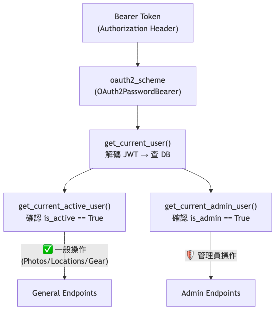
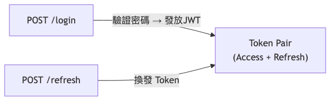
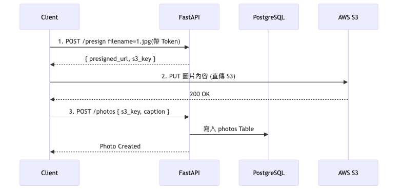
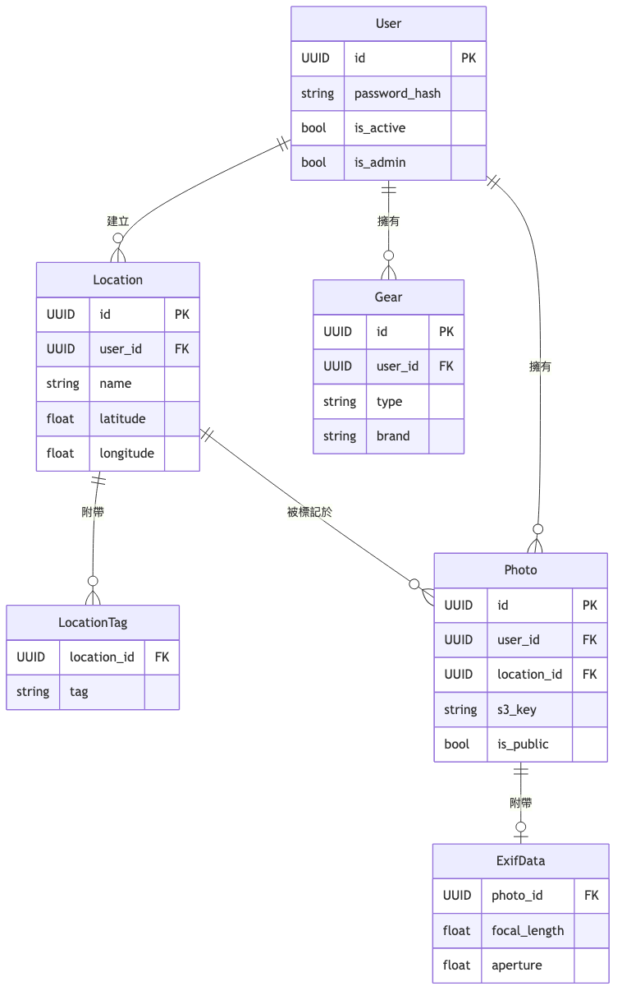

# Backend Structure


## Authentication

In our system, most of the protected requests flow through the authentication chain in `app/api/deps.py`. 
> deps = dependencies



### Core Definition: `get_current_active_user`

```python
# FastAPI Dependency: Ensure the requester is not only successfully logged in, but also not in an inactive state (- is_active=True)
async def get_current_active_user(
    current_user: User = Depends(get_current_user),
) -> User:
    if not current_user.is_active:
        raise HTTPException(status_code=status.HTTP_400_BAD_REQUEST, detail="Inactive user")
    return current_user
```

---

## API List & Structure

### `/api/v1/auth` 
Duty: User registration, login, and token refresh (access and refresh token design).



### `/api/v1/photos`
Duty: Photo upload & storage

**Example: How to upload a photo?**
Our backend does not receive photo files, but adopts a **Direct Upload** mode to reduce server traffic load.
1. The front-end calls `POST /photos/presign` with the file name to obtain the S3 time-limited special URL (`presigned_url`) and S3 key.
2. The front-end takes this valid URL and uploads the file to AWS S3 using `PUT URL` (**without passing through the backend**).
3. The front-end then takes the `s3_key` and the photo title, and calls `POST /photos`, and the backend only stores these text information in the database.



- **Permission Control**: Public users can only list `is_public=True` and only provide queries, while creation, modification, and deletion must be `active user` or the owner of the photo.

### `/api/v1/locations` 
Duty: Location tag

### `/api/v1/gear` 
Duty: Private gear management

- **Permission Control**: Unlike Photos or Locations, all queries in this route are bound to `user_id = current_user.id`. Other users cannot list your gear, and even if they pass in someone else's UUID, they will be automatically blocked and returned as 404 by the `WHERE` condition.

### `/api/v1/stats` 
Duty: Data statistics

- **Underlying Principle**: Use SQLAlchemy `group_by` and `func.count()` to calculate statistics.
  - For example, `GET /stats/me/focal-length`, we use `Photo` to associate with the `ExifData` table to perform calculations.

---

## Database Model & Relationship 

We use **PostgreSQL**, and the model is declared in `app/models/models.py`. The core relationships are as follows:



**Key Relationship**:
1. `Photo` and `ExifData` have a strict one-to-one (`1:1`) relationship because we separate the basic information of the image from the camera parameters to avoid querying too many unnecessary pure values when querying the image list.
2. `Location` and `LocationTag` use `1:N` to support multiple tags, which is convenient for providing richer search attributes in the future.
